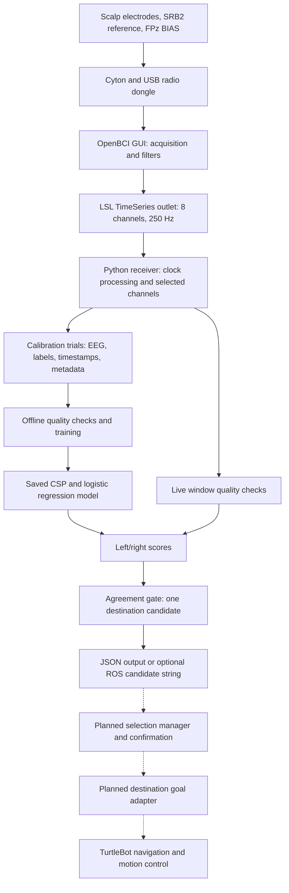
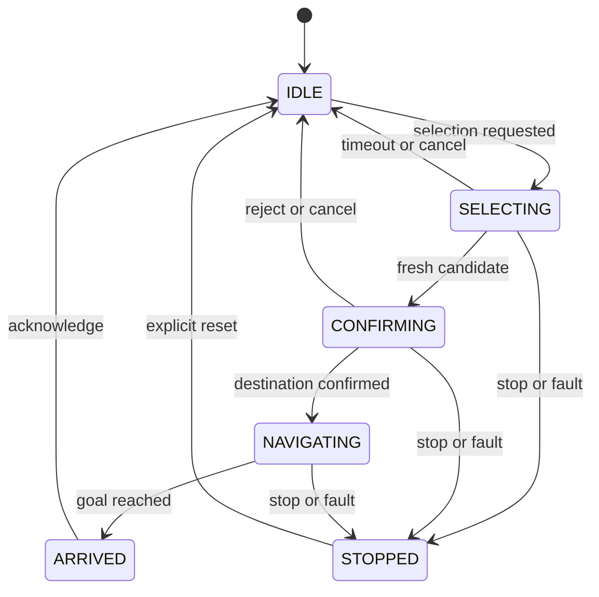

# BrainNav architecture

EECS 149 project: **EEG-guided autonomous destination selection for a TurtleBot**.

This document describes the code in this checkout and the November 19, 2026
recordings. For setup, GUI controls, and copyable terminal commands, use the
[data collection guide](eeg_data_collection.md).

## 1. Goal and scope

The user imagines movement of the left or right hand. A participant-specific
EEG classifier proposes one of two destinations. After confirmation, the robot
should navigate to the selected destination using its own perception and
navigation system.

| Imagery label | Intended destination mapping |
| --- | --- |
| `left` | Destination A, coordinates to be configured |
| `right` | Destination B, coordinates to be configured |
| `rest` | No intended selection; used as a control condition |

The imagery labels are symbolic destination choices, not immediate left/right
wheel commands. No arbitrary word/thought decoder is implemented. Destination
coordinates and the confirmation policy remain integration work.

## 2. Current implementation status

| Component | Status in this repository |
| --- | --- |
| Cyton → OpenBCI GUI → LSL → Python | Implemented and exercised with recorded data |
| Timestamp and basic amplitude checks | Implemented |
| Randomized, labeled calibration collection | Implemented; NPZ trials saved individually |
| CSP + logistic regression training | Implemented; participant baselines saved |
| Separate-recording evaluation | Implemented and exercised |
| Bounded live classification and candidate gate | Implemented; useful intent decoding not established |
| Optional ROS candidate publisher | Implemented on `/bci/destination_candidate` |
| Camera-based cone perception and trajectory controller | Existing ROS 2 code, independent of EEG |
| Confirmed EEG destination → robot goal | Planned; no subscriber/goal adapter is implemented here |
| Integrated stop/watchdog/arrival state machine | Planned; not implemented by the EEG CLI |
| Reliable brain-controlled robot demonstration | Not demonstrated by current model results |

ROS 2/Nav2 may be part of the broader project deployment, but this checkout's
navigation implementation is a custom cone-based trajectory planner and
controller. It does not currently contain a Nav2 destination-action client.

## 3. System data flow

Solid arrows show the implemented EEG path. Dashed arrows show the intended
destination/navigation connection that still needs implementation.



The current cone controller is described separately below; it is not already
connected to the dashed path.

## 4. Hardware

| Hardware | Role and current use |
| --- | --- |
| Ultracortex-style headset and scalp electrodes | Hold electrodes at the intended 10–20 positions |
| Cyton board | Acquires eight EEG inputs; nominal 250 Hz in the selected mode |
| ADS1299 analog front end | Biopotential amplification and 24-bit conversion on Cyton |
| Cyton PIC32MX250F128B microcontroller | Board acquisition/control and communication coordination |
| Daisy expansion | Adds eight inputs for 16-channel operation; unused in the current 8-channel workflow |
| USB radio dongle | Links Cyton wirelessly to the laptop's serial port |
| Battery pack | Powers the headset electronics |
| Laptop | Runs OpenBCI GUI, LSL reception, collection, training, and software prediction |
| TurtleBot and its camera/compute stack | Robot perception, localization inputs, and motion; exact robot model and deployed compute remain to be documented |

Sixteen-channel Cyton+Daisy operation normally changes the nominal radio-stream
rate to 125 Hz. That is a different acquisition configuration requiring matching
channel counts and new calibration; an 8-channel/250 Hz model cannot simply be
reused with it.

### Electrode montage

| Cyton input | Position | Focused-pair use |
| --- | --- | --- |
| CH1, bottom N1P | C3 | Recorded |
| CH2, bottom N2P | Cz | Not selected in focused files |
| CH3, bottom N3P | C4 | Recorded |
| CH4, bottom N4P | P3 | Not selected in focused files |
| CH5, bottom N5P | Pz | Not selected in focused files |
| CH6, bottom N6P | P4 | Not selected in focused files |
| CH7, bottom N7P | O1 | Not selected in focused files |
| CH8, bottom N8P | O2 | Not selected in focused files |
| Bottom SRB, SRB2 | Reference ear clip | Shared reference |
| Bottom BIAS | FPz electrode | Body bias connection |

C3 and C4 are the intended left/right sensorimotor recording locations. Labels
refer to physical scalp positions, while channel numbers refer to board inputs.
FPz serves BIAS here, so the setup uses one SRB2 reference ear clip. The supplied
tutorial table's duplicated P4 entry at CH3 is corrected to C4, consistent with
the diagram and the wearer's confirmed map.

The GUI still streams all eight inputs for focused recordings; the receiver
selects `[1, 3]`. Choosing fewer recorded channels reduces the number of noisy
inputs that can reject a trial, while reducing spatial information available to
the model.

## 5. Software components and boundaries

| Component | Implementation / responsibility |
| --- | --- |
| OpenBCI GUI | Owns serial connection, displays signals, applies GUI filters, publishes LSL |
| pylsl / liblsl | Discovers the outlet and transports samples/timestamps |
| [`stream.py`](../src/eeg/stream.py) | Stream selection, channel selection, clock processing, warm-up, freshness and window timing |
| [`__main__.py`](../src/eeg/__main__.py) | `streams`, `timing`, `check`, `collect`, `train`, `predict`; cue presentation and optional ROS publishing |
| [`signal.py`](../src/eeg/signal.py) | Quality checks, spectral diagnostics, model-band filtering, CSP, band power, decision gate |
| [`model.py`](../src/eeg/model.py) | Trial loading, metadata checks, train/test separation, fitting, evaluation, serialization |
| [`cone_publisher.py`](../src/navigation/perception/perception/cone_publisher.py) | Camera-based YOLO segmentation, cone position estimates, annotated images |
| [`trajectory.py`](../src/navigation/plannedcntrl/plannedcntrl/trajectory.py) | Obstacle-aware waypoint construction, optional smoothing, speed/time parameterization |
| [`turtlebot_control.py`](../src/navigation/plannedcntrl/plannedcntrl/turtlebot_control.py) | Cone snapshot collection, trajectory tracking, and `/cmd_vel` output |

The EEG Python environment uses NumPy, SciPy, scikit-learn, and pylsl, as declared
in [`requirements-eeg.txt`](../requirements-eeg.txt). The collection environment
used Python 3.13 and GUI v5.0.8. Requirements specify version ranges rather than
a fully pinned environment.

ROS components require a compatible ROS 2 environment and message packages.
Perception also imports OpenCV, cv_bridge, and Ultralytics YOLO; control imports
NumPy, tf2_ros, and transforms3d. These are not installed by the EEG requirements
file. ROS Python bindings must be compatible with the interpreter that runs a
ROS-enabled command; do not assume the laptop's Python 3.13 venv includes them.

## 6. Acquisition and timing

The current GUI configuration is Normal EEG input, x24 gain, Bias Include Yes,
SRB2 On, and SRB1 Off. Main GUI filters are 60 Hz notch and 5–50 Hz bandpass;
Networking Filters is On. The LSL outlet is named `obci_eeg1` with type `EEG`.
These settings are part of the experiment and must be kept consistent.

The inlet uses `proc_clocksync | proc_dejitter | proc_monotonize`. Warm-up and
rest/cue intervals continuously consume unlabeled samples. The reader discards
samples timestamped before a requested window's start and does not flush away
the timestamp processor's history.

Current timing checks reject non-finite timestamps, nonpositive intervals,
gaps over four nominal sample periods, and an epoch duration differing by more
than 15% from the nominal sample duration. Freshness checks reject received
timestamps more than 0.75 seconds old or more than 0.25 seconds into the future.
At 250 Hz, four periods is 16 ms.

These are LSL-window checks, not proof that every original board sample was
received. GUI processing and timestamp smoothing can conceal upstream loss;
board sample-counter/raw-recording inspection is a separate check. The `timing`
command compares smoothed and clock-only timestamp behavior without producing
training examples.

## 7. Data and calibration protocol

Each randomized block contains one `left`, one `right`, and one `rest` cue.
Defaults are two seconds relaxation, a 0.5-second cue delay, and a three-second
recording. At 250 Hz a focused trial is two channels by 750 samples. The
in-memory model batch has shape `(trials, channels, samples)`.

Timing-invalid attempts are not saved as training NPZ files. The collector
retries the same task up to three attempts and logs failures in JSONL. Trials
with large amplitudes are saved with a warning and rejected later by the
training loader. Saved count, accepted count, and classifier training count are
therefore different quantities.

### Per-trial NPZ schema

| Field | Meaning |
| --- | --- |
| `samples_uv` | Selected-channel voltages in microvolts, shape `(channels, samples)`; GUI-filtered in the current setup |
| `timestamps` | One processed LSL timestamp per sample, in seconds |
| `fs` | Nominal sample rate in Hz |
| `label` | `left`, `right`, or `rest` |
| `subject` | Anonymous participant identifier |
| `session_id` | Recording UUID |
| `channels` | Original 1-based board inputs, e.g. `[1, 3]` |
| `channel_names` | Corresponding scalp positions, e.g. `['C3', 'C4']` |
| `cue_lsl_time` | Time the imagery cue was presented |
| `cue_delay_seconds` | Requested cue-settling duration |
| `stream_name` | Source LSL outlet name |
| `input_filtering` | Declared upstream filtering, e.g. `gui-5-50-notch60` |
| `acquisition_attempt` | Attempt number that produced the saved trial |

LSL timestamps are not wall-clock timestamps. `input_filtering` records the
operator's declaration; it does not read or change the GUI's actual settings.

The basic amplitude check rejects any selected channel with peak-to-peak
amplitude above 250 µV or standard deviation below 0.1 µV, along with non-finite
or incorrectly shaped data. It runs on the received voltages before the model's
additional 7–30 Hz filtering. Thresholds are initial experiment settings, not
universal physiological criteria or an artifact-removal algorithm.

The loader checks subject, sample rate, channel positions/order, input
filtering, cue delay, and sample count for compatibility. It rejects duplicate
EEG trials and overlapping recording UUIDs when an explicit recording holdout
is supplied. No automatic resampling, channel remapping, or participant pooling
is performed.

Raw GUI recordings remain a separate acquisition artifact. The project's NPZ
files store labeled epochs rather than a complete continuous recording and
do not include the Cyton packet counter.

## 8. Classification model

The main model follows the **CSP + logistic regression architecture** described
in OpenBCI's deprecated motor-imagery tutorial. The implementation is local
Python code, not a downloaded model or the NeuroPype pipeline. Each participant
needs their own fitted parameters.

### Preprocessing

Each complete epoch is demeaned and filtered independently with a fourth-order
Butterworth 7–30 Hz bandpass using forward/backward `sosfiltfilt`. This occurs
after the upstream GUI filtering. Filtering does not carry state across
training and test epochs.

Because the algorithm filters a complete window, inference waits for that
window to arrive. This is buffered window processing, not instantaneous or
sample-by-sample intent decoding.

### Common Spatial Patterns

CSP learns weighted combinations of electrodes whose powers differ between
the two labeled classes. The implementation averages epoch covariance matrices
within each class and shrinks each class covariance 10% toward a scaled
identity matrix. It solves the generalized eigenproblem:

$$
C_L w = \lambda (C_L + C_R)w.
$$

The default keeps two components, selecting opposite ends of the eigenvalue
spectrum. Features are the natural logarithms of each component's mean-square
signal power. CSP is fitted only on training LEFT/RIGHT trials.

### Scaling and logistic regression

`StandardScaler` standardizes the CSP features using training statistics.
`LogisticRegression` uses `C=1.0`, the `lbfgs` solver, balanced class weights,
and a maximum of 1000 iterations. It outputs scores for `left` and `right`.
The feature scaler and classifier are fitted only on training data.

The default model has **no learned REST class**. It always assigns an
unthresholded direction score to a valid input, including an idle input. REST
trials measure unwanted confident classifications and are excluded from the
binary model fit.

### Alternative baseline

`--method bandpower` computes log Welch power in 8–12, 12–16, 16–22, and
22–30 Hz bands for each channel, then uses scaling and shrinkage LDA. This CLI
alternative trains three classes, including REST. A separate exploratory
training-data analysis also tested binary band-power LDA; it is not the
three-class CLI configuration or a replacement for independent validation.

The Sentdex repository was an initial reference, but its 16-channel FFT input
representation differs from the raw TimeSeries windows used here. Its weights
and reported accuracy are not used as evidence for this participant.

## 9. Training, evaluation, and current evidence

With `--test-session`, the model fits accepted training direction trials and
evaluates a separate recording. Without it, the CLI uses a stratified 25%
whole-trial holdout with random seed 149. It does not divide overlapping windows
from one trial between training and test. The no-explicit-test path requires at
least five accepted examples of each required/present class.

Reports include confusion matrices, balanced accuracy, per-class metrics,
rejected trials, exact training/test file lists, candidate coverage at the
chosen threshold, and false-candidate rate on REST windows. The scores are
uncalibrated. Window metrics do not establish whole-selection or robot success.

### Focused recording snapshot: November 19, 2026

| Dataset | Recorded | Accepted LEFT | Accepted RIGHT | Accepted REST | Rejected |
| --- | ---: | ---: | ---: | ---: | ---: |
| `motor_C3_C4_session01` | 90 | 21 | 21 | 17 | 31 |
| `motor_C3_C4_validation01` | 30 | 8 | 9 | 8 | 5 |

The default model fitted all 42 accepted training direction trials. On the
separate recording, it predicted LEFT for all 17 accepted direction trials:

| Actual class | Predicted LEFT | Predicted RIGHT |
| --- | ---: | ---: |
| LEFT | 8 | 0 |
| RIGHT | 9 | 0 |

Accuracy was **47.1%**, and balanced accuracy was **50%**. At score threshold
0.8 it produced no confident candidate windows, including on the eight
accepted REST trials. Thus zero REST false candidates here reflects zero
candidate coverage, not a demonstrated ability to recognize rest.

The training and validation recordings have different UUIDs and disjoint
files, and were collected back-to-back. This is a separate-recording test,
not a different-day or different-participant validation. The result does not
establish useful left/right decoding. Earlier full-montage baselines also
performed poorly; their data and reports were preserved.

The validation results have now been inspected. Future tuning should use
training-only cross-validation and another prospective test recording rather
than repeatedly selecting changes that improve this known validation score.

## 10. Live candidate generation

`predict` loads a trusted locally trained pickle, verifies live sample rate,
selected input order, and declared filtering, then processes non-overlapping
windows of the model's recorded duration.

| Event | Current behavior |
| --- | --- |
| Amplitude/flat/non-finite failure | Reject window and reset agreement count |
| Timing or stream failure | Abort the prediction command through the CLI error handler |
| Score below threshold | Reset agreement count |
| Different direction | Start a new agreement count for that direction |
| Two consecutive direction scores at least 0.8 | Latch and emit one candidate |
| Selection interval expires | Emit a timeout without a destination |

The default active selection interval is 30 seconds, after connection and
warm-up. Two three-second windows require about six seconds of usable data
plus delivery/processing overhead. Low-quality windows can extend the wait
within the selection attempt.

Standard output includes per-window prediction scores and, when selected:

```json
{"event": "destination_candidate", "destination": "left", "requires_confirmation": true}
```

The JSON describes the intended confirmation boundary. It does not implement
a robot confirmation mechanism.

With `--ros`, the CLI publishes one `std_msgs/msg/String` containing `left` or
`right` on `/bci/destination_candidate`, after finding a subscriber. It does not
publish the JSON envelope, timestamps, or a request ID on that topic. The
navigation adapter must enforce freshness, confirmation, and duplicate handling.
The EEG CLI never publishes `/cmd_vel`.

## 11. Existing robot software

The `perception` package reads camera images and intrinsics. Its cone model
uses YOLO segmentation masks and a known cone silhouette area to estimate
positions, transforms them with a fixed camera-to-base transform, and publishes
`geometry_msgs/msg/PoseArray` on `/cones`. This is not a general depth-camera
or obstacle-map implementation. The optional generic COCO model produces
annotated detections without cone-depth output.

The `plannedcntrl` controller collects ten cone messages, consolidates obstacle
positions, and creates a trajectory. The planner currently chooses a goal
**1.8288 m forward** from the starting pose; it does not accept two configured
EEG destinations. It supports straight or smoothed paths and time-parameterizes
the waypoints. The controller uses `odom` → `base_link` TF and publishes velocity
commands at a nominal 20 Hz, capped at 0.22 m/s linear and 2.0 rad/s angular.

| Interface | Current use |
| --- | --- |
| Camera image / CameraInfo topics | Configurable perception inputs |
| `/yolo/annotated_image` | Detection visualization |
| `/cones` | Cone positions consumed by trajectory controller |
| TF `odom` → `base_link` | Robot pose for planning/tracking |
| `/cmd_vel` | Velocity command output from the existing controller |
| `replan` Trigger service | Clears the current plan and re-arms cone collection |
| `/bci/destination_candidate` | Optional EEG output; not consumed by current navigation code |

The controller starts planning after enough cone messages arrive, independently
of EEG. It must not be treated as an EEG-gated listener. It publishes a zero
Twist when its goal-reached condition is met and when replanning is requested,
but does not implement the proposed integrated stop/watchdog policy. In
particular, its control loop returns on missing TF without an explicit stop
command at that point.

## 12. Planned selection and navigation integration

A selection manager should own the high-level task. Its required responsibilities
are to open a deliberate selection interval, accept a fresh candidate only for
that interval, obtain confirmation, map the choice to a configured goal, dispatch
navigation, and monitor cancellation, arrival, and faults.

The following is a **proposed** state machine, not an implemented controller:



The navigation integration can either adapt the current controller to receive
confirmed goals or use a separately configured Nav2 stack. That choice, the
destination coordinate frame, and goal coordinates must be established before
deployment. A stop/cancel path must remain available independently of EEG
classification. Loss of required localization/perception or stale commands
must have an explicit, tested response.

Before robot integration, measure complete deliberate selections: correct,
wrong, rejected/timed out, latency, and false activations during idle periods.
First test the interface without motion, then with an appropriate simulated
or supervised robot setup. Current model performance does not justify
autonomous destination dispatch.

## 13. Files and reproducibility

| Path | Contents |
| --- | --- |
| `data/eeg/motor_session01`, `data/eeg/motor_session02` | Earlier full-montage recordings |
| `data/eeg/motor_C3_C4_session01` | Focused training recording |
| `data/eeg/motor_C3_C4_validation01` | Focused separate validation recording |
| `models/eeg/participant01_csp_C3_C4_session01.pkl` | Fitted focused model and metadata |
| `models/eeg/participant01_csp_C3_C4_session01.json` | Evaluation, rejection reasons, train/test file lists |
| `models/eeg/participant01_C3_C4_data_manifest.json` | Dataset counts and SHA-256 checksums for all 120 focused files |
| `models/eeg/*training_cv.json` | Exploratory training-only diagnostics; distinct from held-out results |
| [`tests/test_eeg.py`](../tests/test_eeg.py) | Synthetic model, stream, timing, and failure-path checks |

Data and model directories are excluded from Git. Keep their originals and
backups separately from source control; a source push does not include them.
Only load trusted pickle model files. Preserve the participant's montage,
reference/bias arrangement, GUI filters, task instructions, and environment
versions when reproducing an experiment. Synthetic test success verifies
software behavior, not physiological decoding accuracy.

## References

- [OpenBCI motor-imagery tutorial](https://docs.openbci.com/Deprecated/MotorImagery/) — montage and CSP/logistic-regression approach; deprecated.
- [OpenBCI Cyton SDK](https://docs.openbci.com/Cyton/CytonSDK/) — board hardware and channel operation.
- [OpenBCI GUI widgets](https://docs.openbci.com/Software/OpenBCISoftware/GUIWidgets/) — hardware settings and LSL networking.
- [MNE CSP explanation](https://mne.tools/stable/auto_tutorials/machine-learning/50_decoding.html#common-spatial-pattern) — background for spatial features; MNE is not a runtime dependency here.
- [scikit-learn LogisticRegression](https://scikit-learn.org/stable/modules/generated/sklearn.linear_model.LogisticRegression.html) — classifier implementation.
- [LSL timestamp synchronization](https://labstreaminglayer.readthedocs.io/info/time_synchronization.html) — clocks and timestamp processing.
- [Kinesthetic and visual motor imagery study](https://pubmed.ncbi.nlm.nih.gov/16236487/) — rationale for testing movement-sensation instructions.
